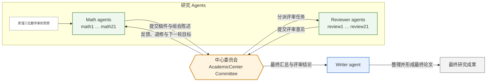

## 问题分类结果

| 子问题              | 负责 agent |
| ---------------- | -------- |
| S1：Type I(1)     | math1    |
| S2：Type I(2)     | math2    |
| S3：Type I(3)     | math3    |
| S4：Type I(6)     | math4    |
| S5：Type II(1)    | math5    |
| S6：Type II(3)    | math6    |
| S7：Type III(1)   | math7    |
| S8：Type IV(1,1)  | math8    |
| S9：Type IV(2,1)  | math9    |
| S10：Type IV(3,1) | math10   |
| S11：Type IV(6,1) | math11   |
| N1：5+1           | math12   |
| N2：4+2           | math13   |
| N3：4+1+1         | math14   |
| N4：3+3           | math15   |
| N5：3+2+1         | math16   |
| N6：3+1+1+1       | math17   |
| N7：2+2+2         | math18   |
| N8：2+2+1+1       | math19   |
| N9：2+1+1+1+1     | math20   |
| N10：1+1+1+1+1+1  | math21   |

~={red}每一个分裂后的子问题，目标都是证明该类六维阿贝尔簇的 Hodge 类结构及其代数性，并确定除子类、Weil 类和异常类的情况。=~


## 流程示意


### 工程实现细节 


**1. Codex SDK 如何发挥作用**：~={red}Codex SDK 为每个 math、reviewer 和 writer agent 创建并维持独立的持久化 thread，并通过 Goal 驱动它们持续执行任务=~。每个 agent 的 `AGNET` 和 Skills 规定其身份、研究流程、输出要求以及何时调用委员会工具；SDK 负责运行、暂停和恢复这些 agent。  

**2. 中心委员会如何发挥作用**：~={red}中心委员会由独立后端提供 MCP 服务=~，通过 `committee_submit_manuscript`、`committee_get_review_task`、`committee_submit_review`、消息和组会等接口，让 agent 能够提交成果、领取任务、返回评审并参与讨论。Math agent 通过 MCP 提交稿件后，委员会登记并分派给 reviewer agent；~={red}r**eviewer agent 按 Skills 要求完成评审并回传意见**=~，委员会再把反馈和下一轮目标返回 math agent，最后将汇总结果交给 writer agent 整理成最终成果。  


---


# Appendix
## codex SDK 接口

| Codex SDK 接口 / 能力 | 工程用途 | Goal 模式关键点 |
|---|---|---|
| `Codex()` | 启动一个 SDK 客户端 | 客户端连接成功 |
| `thread_start(...)` | 创建 agent 的持久化会话 | 必须使用持久化 thread |
| `thread.run(message)` | 执行一轮任务并等待结果 | 适合普通短任务 |
| `thread.turn(message)` | 启动一轮并取得控制句柄 | 可监听、暂停或中断 |
| `turn.stream()` | 读取运行事件 | 观察 Goal 的连续轮次 |
| `turn.interrupt()` | 中断当前轮次 | 组会或超时时停止 |
| `thread_resume(thread_id)` | 恢复已有会话 | 进程重启后继续 |
| `thread.read(include_turns=True)` | 读取会话和历史 | 委员会恢复状态 |
| `start_goal_operation(thread_id, objective)` | 设置并启动长期目标 | 返回 Goal 状态和逻辑 turn |
| `thread_goal_set(..., status=active)` | 激活或更新目标 | 目标进入 `active` |
| `pause_goal(thread_id)` | 暂停长期目标 | 目标进入 `paused` |
| Goal 启动成功 | 委员会获得 `thread_id`、目标状态和首个 turn | `start_goal_operation` 成功返回 |
| Goal 任务成功 | agent 完成目标并停止继续轮次 | 状态为 `complete`，收到 `turn/completed` |
| Goal 任务未完成 | 需要继续工作或人工处理 | 状态为 `blocked`、`budgetLimited` 或 `usageLimited` |


## 参考链接

### 官方文档与协议

- [OpenAI Codex SDK 文档](https://developers.openai.com/codex/sdk/)
- [OpenAI Codex 项目仓库](https://github.com/openai/codex)
- [Codex Skills 文档](https://developers.openai.com/codex/skills/)
- [Model Context Protocol（MCP）介绍](https://modelcontextprotocol.io/docs/getting-started/intro)
- [MCP 官方 Python SDK](https://github.com/modelcontextprotocol/python-sdk)
- [Python `sqlite3` 文档](https://docs.python.org/3/library/sqlite3.html)
- [Mermaid 图表文档](https://mermaid.js.org/intro/)

### 本项目实现

- [GitHub 仓库：26springFu_research](https://github.com/pillow0705/26springFu_research)

### 代码架构

```text
03/
├── agent/
│   ├── math1 … math21/
│   │   ├── .codex/
│   │   ├── AGNET
│   │   └── skills/
│   ├── review1 … review21/
│   │   ├── .codex/
│   │   ├── AGNET
│   │   └── skills/
│   └── Writer/
│       ├── .codex/
│       ├── AGNET
│       └── skills/
├── committee/
│   ├── mcp_server.py
│   ├── service.py
│   └── start_lab.py
├── tests/
├── monitor_server.py
├── start_lab.py
├── README.md
└── slide.md
```


