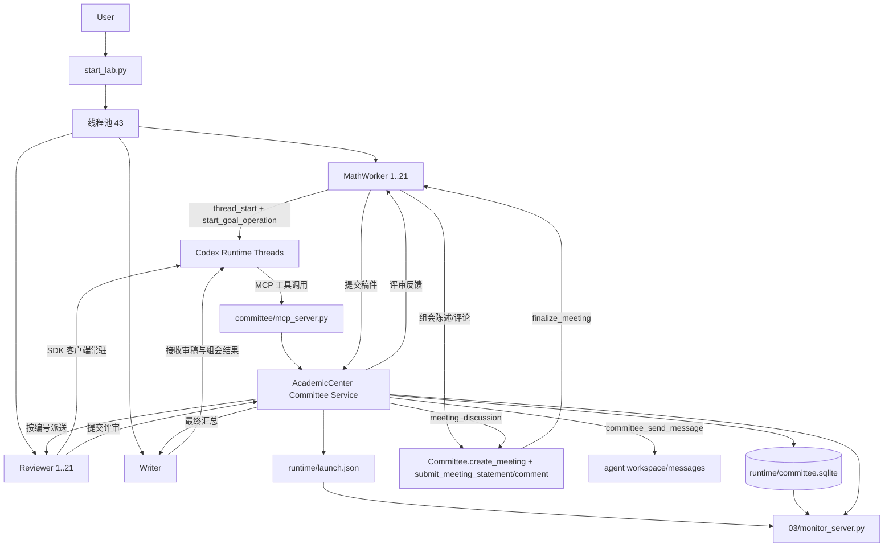

| 子问题 | 负责 agent |
|---|---|
| S1：Type I(1) | math1 |
| S2：Type I(2) | math2 |
| S3：Type I(3) | math3 |
| S4：Type I(6) | math4 |
| S5：Type II(1) | math5 |
| S6：Type II(3) | math6 |
| S7：Type III(1) | math7 |
| S8：Type IV(1,1) | math8 |
| S9：Type IV(2,1) | math9 |
| S10：Type IV(3,1) | math10 |
| S11：Type IV(6,1) | math11 |
| N1：5+1 | math12 |
| N2：4+2 | math13 |
| N3：4+1+1 | math14 |
| N4：3+3 | math15 |
| N5：3+2+1 | math16 |
| N6：3+1+1+1 | math17 |
| N7：2+2+2 | math18 |
| N8：2+2+1+1 | math19 |
| N9：2+1+1+1+1 | math20 |
| N10：1+1+1+1+1+1 | math21 |

每一个分裂后的子问题，目标都是证明该类六维阿贝尔簇的 Hodge 类结构及其代数性，并确定除子类、Weil 类和异常类的情况。

| Codex SDK 接口 / 能力 | 工程用途 | Goal 模式关键点 |
|---|---|---|
| `Codex()` | 启动一个 SDK 客户端 | 客户端连接成功 |
| `thread_start(...)` | 创建 agent 的持久化会话 | 必须使用持久化 thread |
| `thread.run(message)` | 执行一轮任务并等待结果 | 适合普通短任务 |
| `thread.turn(message)` | 启动一轮并取得控制句柄 | 可监听、暂停或中断 |
| `turn.stream()` | 读取运行事件 | 观察 Goal 的连续轮次 |
| `turn.interrupt()` | 中断当前轮次 | 组会或超时时停止 |
| `thread_resume(thread_id)` | 恢复已有会话 | 进程重启后继续 |
| `thread.read(include_turns=True)` | 读取会话和历史 | 委员会恢复状态 |
| `start_goal_operation(thread_id, objective)` | 设置并启动长期目标 | 返回 Goal 状态和逻辑 turn |
| `thread_goal_set(..., status=active)` | 激活或更新目标 | 目标进入 `active` |
| `pause_goal(thread_id)` | 暂停长期目标 | 目标进入 `paused` |
| Goal 启动成功 | 委员会获得 `thread_id`、目标状态和首个 turn | `start_goal_operation` 成功返回 |
| Goal 任务成功 | agent 完成目标并停止继续轮次 | 状态为 `complete`，收到 `turn/completed` |
| Goal 任务未完成 | 需要继续工作或人工处理 | 状态为 `blocked`、`budgetLimited` 或 `usageLimited` |

工程实现方法（不超过10行）：
1. 用 `CodexConfig/Codex/ApprovalMode` 在 `03/committee/start_lab.py` 统一配置 `gpt-5.5` + `ApprovalMode.deny_all`，一次性启动 43 个 thread。  
2. 每个 math 线程通过 `thread_start` 建立持久化会话并发起 `start_goal_operation`，目标来源于各自 `AGNET` 与 `agent.md`。  
3. 所有线程的 `thread_id` 与 goal 状态统一落盘到 `03/runtime/launch.json`，供监控与续跑。  
4. 数学线程产出后调用 `committee_submit_manuscript`，由服务端做路径校验与副本落库。  
5. `committee_submit_manuscript` 触发 `AcademicCenter Committee Service` 在 SQLite 中创建 `submissions` 并分配 `reviewer_id=mathn`。  
6. Reviewer 线程读取任务并调用 `committee_submit_review` 回填 `APPROVE/REJECT + comments`。  
7. 当 review 阶段结束或触发会签，委员会通过 `committee_get_review_result` 汇总结果并推送给对应 math agent。  
8. 组会流程走 `committee_create_meeting -> submit_meeting_statement -> submit_meeting_comment -> finalize_meeting -> submit_meeting_synthesis`。  
9. Writer 仅订阅委员会回传的汇总与反馈并执行最终梳理，完成研究内容压缩产物。  
10. `03/monitor_server.py` 只读 `launch.json` 与 `committee.sqlite`，提供实时可视化与 `/api/state` 查询。  
